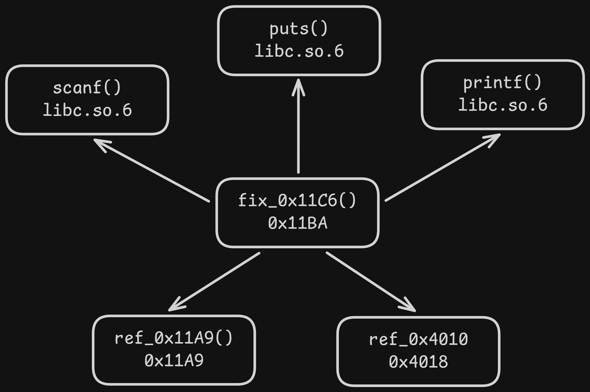
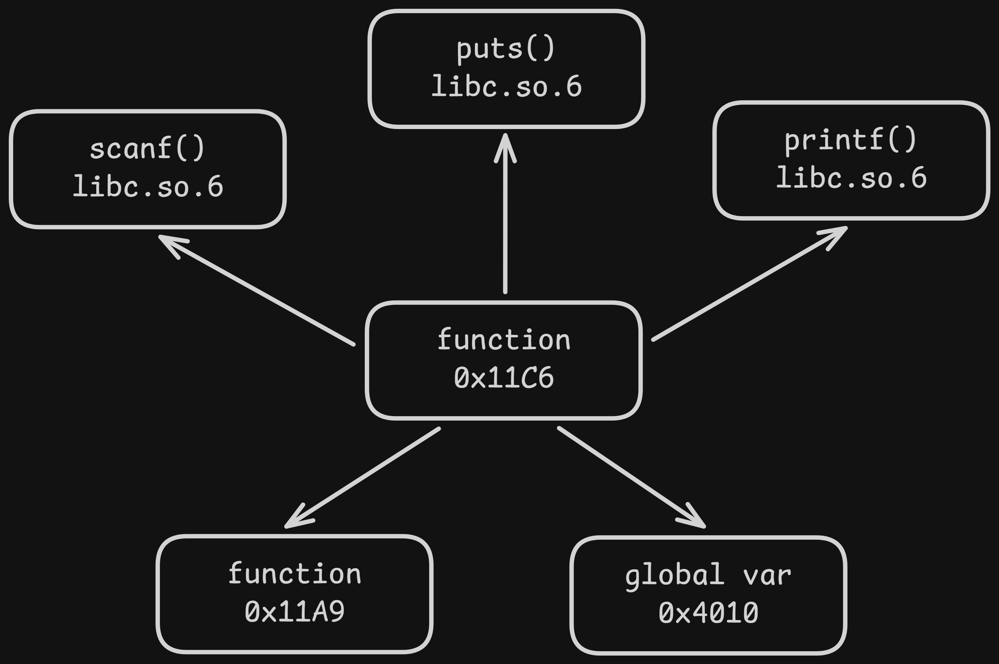
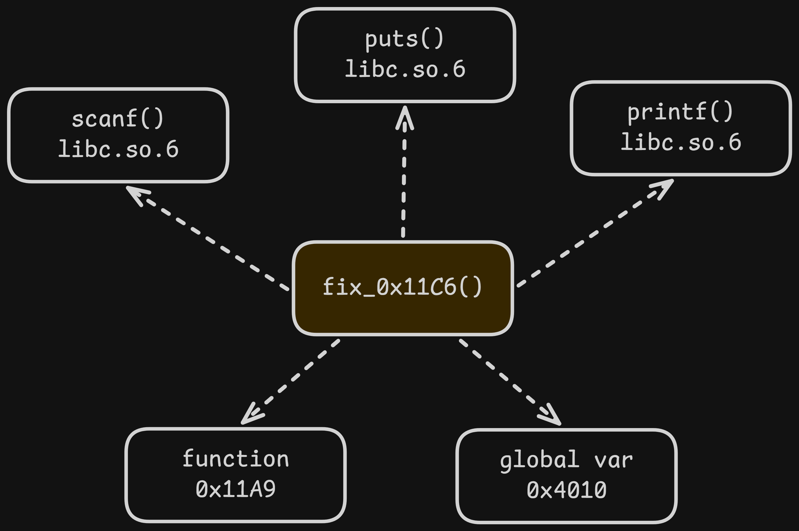

## Introduction

This work introduces [1-patch](https://github.com/FazeCT/1-patch), a static binary patcher that demonstrates the usage of patches written in high-level programming languages in patching binaries. Currently, it supports C, and works with patching x86-64 ELF binaries. 

## Methodology

Normally, binary patches are made by either inline replacing with new code, or binary lifting to insert new instructions. This work aims to leverage a technique called *code insertion/injection* to insert user-written C code into the binary.

For a new item (global variable/function) to be added to the binary, sufficient regions in the binary are needed to contain them. Merging happens between components such as relocation table and GOT/PLT between the original code and the integrated code. New sections and segments could be created just in case.

To completely replace a global variable or a function, **every reference** that points to the original element must be diverted to point to the new definition. The tool operates a linear scan to detect all read/write reference (in case of a global variable) and all `call/jmp` instructions (in case of a function).

The tool also attempts to place a *trampoline* `jmp` (if possible) in place of the original function to redirect the flow to the fixed function. This is solely utilized for catching indirect calls that we cannot scan for.

**Then why don't we just install a trampoline and ignore the references change?** That is because, the rely-on-trampoline solution is not guaranteed to be always applicable. For instance, an *n*-byte `jmp` cannot be installed properly if the length of the original code
is smaller than *n* - as an example, a `ret` stub function. 

The trampoline insertion also skips over `endbr64` to retain the usability of [CET](https://hacktricks.wiki/en/binary-exploitation/common-binary-protections-and-bypasses/cet-and-shadow-stack.html) in a binary, if the protection exists. And since `endbr64` is treated as a `nop` in a non-CET binary, `-fcf-protection=full` is safely enabled by default when compiling C patches.

Consider the following case where the `main()` function at 0x11C6 needs to be replaced:

<div class="flex gap-2 [&>*>*]:my-0">



</div>

The diagrams illustrate **simplified** *reference graphs* of the compiled code from the C patch and the target binary, respectively (yes, dynamically linked functions/methods are also strongly supported by the tool).

<div class="mx-auto w-1/2">
    
</div>

In the final reference graph of the patched binary, the yellow node represents the new component (new `main()` definition) that was replaced from the patch binary. The dashed arrow lines indicate the references that were patched during the integration process, connecting the newly merged components with the existing symbols in the target binary.

## Installation

### Install dependencies

These instructions target Ubuntu x86-64, including WSL. The build requires CMake 3.24 or newer.

```bash caption="" /apply/ /components/
sudo apt update
sudo apt install -y build-essential cmake git binutils libdwarf-dev libelf-dev zlib1g-dev

cmake --version
```

The project also needs the LIEF C++ SDK. Install LIEF 1.0.0 into your user directory:

```bash caption="" /apply/ /components/
mkdir -p "$HOME/src"
git clone --depth 1 --branch 1.0.0 \
  https://github.com/lief-project/LIEF.git "$HOME/src/LIEF"

cmake -S "$HOME/src/LIEF" -B "$HOME/src/LIEF/build" \
  -DCMAKE_BUILD_TYPE=Release \
  -DLIEF_PYTHON_API=OFF \
  -DLIEF_EXAMPLES=OFF \
  -DLIEF_TESTS=OFF \
  -DCMAKE_INSTALL_PREFIX="$HOME/.local"

cmake --build "$HOME/src/LIEF/build" --target install -j2
```

Capstone and Keystone are installed and built automatically during the project build.

### Build and test

```bash caption="" /apply/ /components/
git clone https://github.com/FazeCT/1-patch.git
cd 1-patch

cmake -S . -B build \
  -DCMAKE_BUILD_TYPE=Release \
  -DCMAKE_PREFIX_PATH="$HOME/.local"

cmake --build build -j"$(nproc)"
ctest --test-dir build --output-on-failure
```

The first project build needs access to GitHub to fetch Capstone and Keystone. 

If CMake cannot find LIEF, locate `LIEFConfig.cmake` with:

```bash caption="" /apply/ /components/
find "$HOME/.local" -name LIEFConfig.cmake
```

and pass its containing directory as `-DLIEF_DIR=<dir_here>`.

## Documentation

### Usage 

```bash caption="" /apply/ /components/
./1-patch -p PATCH_CODE -i TARGET_BINARY -o OUTPUT_BINARY [OPTIONS]
```

In which, `PATCH_CODE` is the path to the C patch, while `TARGET_BINARY` is the path to the binary that should be patched and `OUTPUT_BINARY` (optional) is the path to the output binary. 

`-h/--help` and `-v/--verbose` are also available.

### Patch syntax

Three prefixes are introduced to write patches: `add_`, `ref_` and `fix_`.

```c caption="" showLineNumbers{1} /apply/ /components/
int add_var1 = 1;
volatile int add_var2 = 2;

void ref_0x12A1 () {};

volatile int fix_0x11C6 () {
    ref_0x12A1 ();
    return add_var1;
};
```

`add_` (usage: `add_[identifier]`) is used in case a new global variable or a function needs to be added to the binary.

`ref_` (usage: `ref_[virtual address]_[identifier]`) is used when an existing global variable or a function in the binary needs to be reused in the patch code.

`fix_` (usage: `fix_[virtual address]_[identifier]`) is used for completely replacing a global variable or a function with the new definition.

`volatile` keyword must be used in case a global variable or a function is added but never used in the patch code to avoid compiler optimization. This is usually used for declaring elements with `add_` or `fix_` prefixes.

For more details, patch examples can be accessed [here](https://github.com/FazeCT/1-patch/examples).

### External methods

In case a dynamically linked method needs to be invoked in the patch (for example, `printf()`), there are two options:

- Include the corresponding library and use the method.

```c caption="" showLineNumbers{1} /apply/ /components/
#include <stdio.h>

int fix_0x11C6 () {
    printf("hello, world!\n");
};
```

- Declare the method with `ref_` and their virtual address in the target binary, and use the method. This only works when the method is already imported in the binary (obviously).

```c caption="" showLineNumbers{1} /apply/ /components/
int ref_0x5FEC0_printf(const char *format, ...) {};

int fix_0x11C6 () {
    ref_0x5FEC0_printf("hello, world!\n");
};
```

### Structs and enumerations

Refer to [this example for patching objdump](https://github.com/FazeCT/1-patch/examples/objdump/objdump_patch.c) for more information.

## Licenses

This work is protected under [MIT License](https://github.com/FazeCT/1-patch/LICENSE).

## Extra Information

This work was my Computer Science Bachelor's thesis in Ho Chi Minh City University of Technology (late 2024).

This work was based on [CRISPR](https://www.politesi.polimi.it/handle/10589/177822) by Filippo Cremonese @ Politecnico di Milano and [Redback](https://groundx.io/redback/) by Quynh Nguyen Anh @ Blackhat Asia 2020.