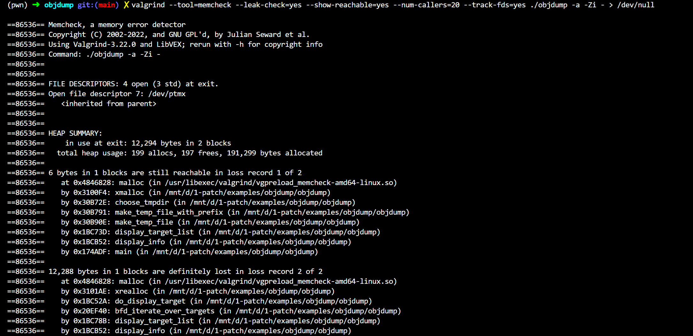
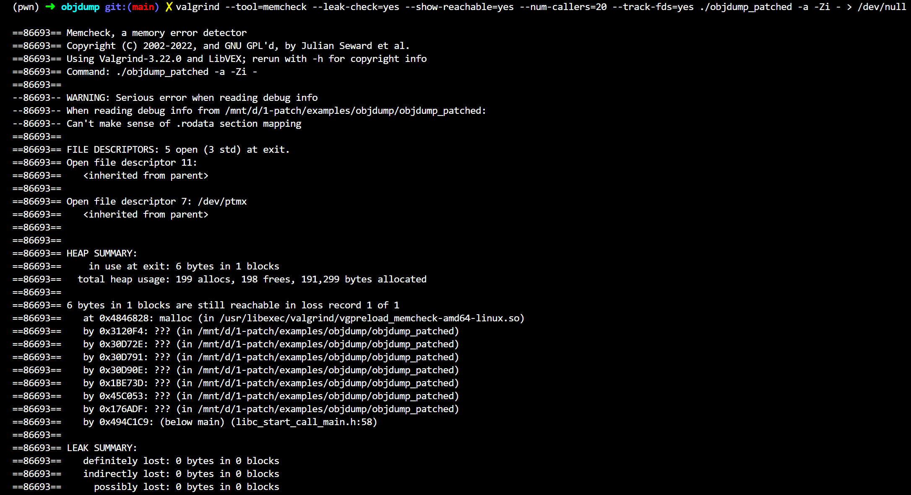

## Introduction

This work introduces [1-patch](https://github.com/FazeCT/1-patch), a static binary patcher that demonstrates how high-level patch code can be used to modify binaries. It currently supports C/C++ patches for x86-64 ELF binaries.

## Methodology

This work uses *code insertion/injection* to insert user-written C/C++ code directly into an existing binary.

The tool supports patch code that references existing global variables and functions in the original binary. It also supports calls to functions from external libraries, allowing inserted C/C++ patches to interact naturally with both the original program and linked libraries.

If the new implementation of a global variable or function could be safely installed in place of the original element in respect of the size constraint, the tool operates in-place patching to directly replace the original code.

If in-place patching cannot be used, new components and replacement functions that need separate space are placed in new sections. The tool integrates them by updating relocation entries and GOT/PLT information. GOT entries in the original binary are automatically reused by the patched function if semantics match.

In this case, to completely replace an existing global variable or function, **every reference** to the original definition must be redirected to the new one being placed in new sections/segments. For global variables, the tool performs a linear scan to detect read and write references. For functions, it scans for direct `call` and `jmp` instructions and rewrites them to target the replacement function.

Consider the following case where the `main()` function at 0x11C6 needs to be replaced:

<div class="flex gap-2 [&>*>*]:my-0">


</div>

The diagrams illustrate **simplified** *reference graphs* of the compiled code from the C/C++ patch and the target binary, respectively.

<div class="mx-auto w-1/2">
    
</div>

In the final reference graph of the patched binary, the yellow node represents the inserted component, namely the replacement `main()` definition from the patch binary. The dashed arrow lines indicate the references that were patched during the integration process, connecting the newly merged components with the existing symbols in the target binary.

In addition to reference patching, the tool also attempts to install a *trampoline* `jmp` in place of the original function to redirect control flow to the fixed function when possible. This is used solely to catch indirect calls that cannot be discovered through linear scanning. **However, the tool cannot rely solely on trampolines and completely ignore reference patching.** A trampoline is not always installable because the original function may be too small to contain the required jump instruction. For example, a stub function consisting only of `ret` may not provide enough bytes for an `n`-byte `jmp`. Therefore, reference rewriting is still required even when trampoline insertion succeeds.

The trampoline insertion skips over `endbr64` to preserve the usability of [CET](https://hacktricks.wiki/en/binary-exploitation/common-binary-protections-and-bypasses/cet-and-shadow-stack.html) in a binary, if the protection exists. Because `endbr64` behaves as a `nop` when CET is not enabled, C/C++ patches are compiled with `-fcf-protection=full` by default.

## Quick example

This example patches [CVE-2025-3198](https://vuldb.com/submit/545773), a memory leak affecting GNU Binutils 2.43 and 2.44. The issue is located in `display_info()`, implemented in `binutils/bucomm.c` and used by the `objdump` component.

To reproduce the vulnerable build, this example uses the source tree at commit `57f3676f3e5266829a91880d61143ab9ecd617bd`.

```c caption="Vulnerable display_info() function of binutils/bucomm.c, decompiled" showLineNumbers{1} /apply/ /components/
__int64 display_info()
{
  _BYTE v1[8]; // [rsp+0h] [rbp-30h] BYREF
  unsigned int v2; // [rsp+8h] [rbp-28h]
  unsigned __int64 v3; // [rsp+28h] [rbp-8h]

  v3 = __readfsqword(0x28u);
  printf("BFD header file version %s\n", "(GNU Binutils) 2.43");
  display_target_list(v1);
  if ( !v2 )
    display_target_tables(v1);
  return v2;
}
```

```c caption="Vulnerable display_info() function of binutils/bucomm.c, source code" showLineNumbers{1} /apply/ /components/
int display_info (void)
{
  struct display_target arg;
  printf (_("BFD header file version %s\n"), BFD_VERSION_STRING);
  display_target_list (&arg);
  if (!arg.error) 
    display_target_tables (&arg);
  return arg.error;
}
```

The leak can be confirmed with [Valgrind](https://valgrind.org) by running `objdump` through memcheck.

```bash caption="" /apply/ /components/
valgrind --tool=memcheck --leak-check=yes --show-reachable=yes --num-callers=20 --track-fds=yes ./objdump -a -Zi - > /dev/null
```

<div class="mx-auto">
    
</div>

Valgrind reports a *definitely lost* leak of 12,288 bytes originating from `display_info()`.

The fix introduced in commit `ba6ad3a18cb26b79e0e3b84c39f707535bbc344d` releases the allocated target information by calling `free(arg.info)` before `display_info()` returns.

```c caption="C patch for display_info()" showLineNumbers{1} /apply/ /components/
#include <stdio.h>
#include <stddef.h>
#include <stdlib.h>

enum { BFD_ARCH_LAST = 0x57, BFD_ARCH_OBSCURE = 0x1 };

struct display_target {
  char *filename;
  int error;
  int count;
  size_t alloc;
  struct {
    const char *name;
    unsigned char arch[BFD_ARCH_LAST - BFD_ARCH_OBSCURE - 1];
  } *info;
};

const char ref_0x230A90_gnu_binutils_version[];
const char ref_0x230AA4_bfd_version[];

void ref_0xB4724_display_target_list(struct display_target *arg) {};
void ref_0xB4971_display_target_tables(const struct display_target *arg) {};

int fix_0xB4B0E_display_info() {
    struct display_target arg;

    printf(ref_0x230AA4_bfd_version, ref_0x230A90_gnu_binutils_version);

    ref_0xB4724_display_target_list(&arg);
    if (!arg.error)
        ref_0xB4971_display_target_tables(&arg);
    
    // Patch: free the allocated target information
    free(arg.info);
    return arg.error;
}
```

The patch reconstructs `display_info()` by referencing symbols that already exist in the target binary. It keeps the original behavior, then adds `free(arg.info)` so the heap allocation is released before returning.

After applying the patch, the leak disappears from the Valgrind report.

<div class="mx-auto">
    
</div>

```c caption="Fixed reference from main() to new display_info(), decompiled" showLineNumbers{1} /apply/ /components/
int __fastcall main(int argc, const char **argv, const char **envp)
{
  // ...
  if ( formats_info )
  {
    exit_status = display_info_0();
  }
}
```
```c caption="Trampoline installed successfully in original display_info(), decompiled" showLineNumbers{1} /apply/ /components/
__int64 display_info()
{
  return display_info_0();
}
```
```c caption="Fixed display_info(), decompiled" showLineNumbers{1} /apply/ /components/
__int64 display_info_0()
{
  _BYTE v1[8]; // [rsp+0h] [rbp-20h] BYREF
  unsigned int v2; // [rsp+8h] [rbp-18h]
  __int64 v3; // [rsp+18h] [rbp-8h]

  printf("BFD header file version %s\n", "(GNU Binutils) 2.43"); // reused printf@GOT
  display_target_list(v1);
  if ( !v2 )
    display_target_tables(v1);
  sub_351000(v3); // dynamically resolved to free()
  return v2;
}
```

## Installation

### Install dependencies

These instructions target Ubuntu x86-64, including WSL. The build requires CMake 3.24 or newer.

```bash caption="" /apply/ /components/
sudo apt update
sudo apt install -y build-essential cmake git binutils libdwarf-dev libelf-dev zlib1g-dev

cmake --version
```

The project also needs the LIEF C++ SDK. Install LIEF 1.0.0 into your user directory:

```bash caption="" /apply/ /components/
mkdir -p "$HOME/src"
git clone --depth 1 --branch 1.0.0 \
  https://github.com/lief-project/LIEF.git "$HOME/src/LIEF"

cmake -S "$HOME/src/LIEF" -B "$HOME/src/LIEF/build" \
  -DCMAKE_BUILD_TYPE=Release \
  -DLIEF_PYTHON_API=OFF \
  -DLIEF_EXAMPLES=OFF \
  -DLIEF_TESTS=OFF \
  -DCMAKE_INSTALL_PREFIX="$HOME/.local"

cmake --build "$HOME/src/LIEF/build" --target install -j2
```

Capstone and Keystone are installed and built automatically during the project build.

### Build and test

```bash caption="" /apply/ /components/
git clone https://github.com/FazeCT/1-patch.git
cd 1-patch

cmake -S . -B build \
  -DCMAKE_BUILD_TYPE=Release \
  -DCMAKE_PREFIX_PATH="$HOME/.local"

cmake --build build -j"$(nproc)"
ctest --test-dir build --output-on-failure
```

The first project build needs access to GitHub to fetch Capstone and Keystone. 

If CMake cannot find LIEF, locate `LIEFConfig.cmake` with:

```bash caption="" /apply/ /components/
find "$HOME/.local" -name LIEFConfig.cmake
```

and pass its containing directory as `-DLIEF_DIR=<dir_here>`.

## Documentation

### Usage 

```bash caption="" /apply/ /components/
./1-patch -p PATCH_CODE -i TARGET_BINARY -o OUTPUT_BINARY [OPTIONS]
```

Here, `PATCH_CODE` is the path to the C/C++ patch, while `TARGET_BINARY` is the path to the binary that should be patched and `OUTPUT_BINARY` (optional) is the path to the output binary. 

`-h/--help` and `-v/--verbose` are also available.

Use `--cpp-runtime` for C++ patches requiring constructors, destructors, exceptions, RTTI, thread-local storage (TLS), or C++ runtime dependencies:

```bash caption="" /apply/ /components/
./1-patch --cpp-runtime -p CPP_PATCH_CODE -i TARGET_BINARY -o OUTPUT_BINARY [OPTIONS]
```

Runtime mode embeds a compiled shared object `.so` in the binary and loads it from an in-memory file during startup. The target binary must be dynamically linked and contain `DT_INIT`, and the runtime environment must allow `/proc/self/exe` and `memfd_create`. Patch constructors run before the target’s global constructors in runtime mode.

### Compiler options and ABI compatibility

`gcc` is the default compiler for C patches.

`g++` is the default C++ compiler. It is possible to select a compiler and language standard, supply includes/macros, and link extra sources or libraries:

```bash caption="" /apply/ /components/
./1-patch --cpp-runtime --cxx g++ --std c++20 -I "include directory" -D_GLIBCXX_USE_CXX11_ABI=1 --source helper.cpp -L "library directory" -lsupport -p CPP_PATCH_CODE -i TARGET_BINARY -o OUTPUT_BINARY [OPTIONS]
```

In which:
- `--cxx COMPILER` declares the chosen compiler (g++/clang++).
- `--std STANDARD` decides the C++ language standard.
- `-I DIR` / `--include-dir DIR` adds an include directory.
- `-D NAME[=VALUE]` / `--define NAME[=VALUE]` defines a pre-processor macro.
- `--source FILE` allows the compilation of an additional source file.
- `-L DIR` / `--library-dir DIR` adds a library search directory.
- `-l NAME` / `--library NAME` links a named library.
- `--link-file FILE` links an explicit object file or archive.

Directory, macro, source, and library options can be repeated. Objects or archives linked into a runtime payload must be suitable for a shared object, normally with `-fPIC`. Additional shared libraries remain host dependencies.

With libstdc++, match `_GLIBCXX_USE_CXX11_ABI` when sharing objects such as `std::string`. 

Exceptions need compatible C++ runtime support and must respect `noexcept`.

### Patch syntax

Three prefixes are used to write patches: `add_`, `ref_` and `fix_`.

```c caption="Patch syntax for C" showLineNumbers{1} /apply/ /components/
int add_var1 = 0;
volatile int add_var2 = 1;

void ref_0x12A1 () {};

int fix_0x11C6 () {
    ref_0x12A1 ();
    return add_var1;
};
```

```cpp caption="Patch syntax for C++" showLineNumbers{1} /apply/ /components/
extern "C" {
    int add_var1 = 1;
    int add_var2 = 2;

    int ref_0x401100_helper(int value) { return 0; };

    int fix_0x401200_target(int value) {
        return ref_0x401100_helper(value) + add_var2;
    }
}
```

`add_` (usage: `add_[identifier]`) is used when a new global variable or function needs to be added to the binary.

`ref_` (usage: `ref_[virtual address]_[(optional) identifier]`) is used when an existing global variable or a function in the binary needs to be reused in the patch code.

`fix_` (usage: `fix_[virtual address]_[(optional) identifier]`) is used for completely replacing a global variable or a function with the new definition.

A global variable should be declared with `volatile` when its reads and writes must be preserved, preventing reads from being replaced with compile-time constants.

`extern "C"` linkage must also be included within C++ patches to disable C++ name mangling for the parser to function correctly. 

In C++, the `ref_` function body is a dummy definition; calls are still redirected to the existing target implementation, however **the declaration must match with the original function's ABI**. In `--cpp-runtime` mode, declare `ref_` functions and variables without definitions instead.

For more details, patch examples can be accessed [here](https://github.com/FazeCT/1-patch/tree/main/examples).

### External methods

In case a dynamically linked function needs to be invoked in the patch (for example, `printf()`), there are two options:

- Include the corresponding header and link the library if needed, then use the method.

```c caption="Patch syntax for C" showLineNumbers{1} /apply/ /components/
#include <stdio.h>

int fix_0x11C6 () {
    printf("hello, world!\n");
    return 0;
};
```

```cpp caption="Patch syntax for C++" showLineNumbers{1} /apply/ /components/
#include <cstdio>

extern "C" int fix_0x401200_target() {
    return std::printf("hello, world!\n");
}
```

- Declare the function with `ref_` and its virtual address in the target binary, and use the method. This only works when the method is already imported in the binary.

```c caption="Patch syntax for C" showLineNumbers{1} /apply/ /components/
int ref_0x5FEC0_printf(const char *format, ...) {};

int fix_0x11C6 () {
    ref_0x5FEC0_printf("hello, world!\n");
    return 0;
};
```

```cpp caption="Patch syntax for C++" showLineNumbers{1} /apply/ /components/
// dummy function body for non --cpp-runtime patches
extern "C" int ref_0x401030_printf(const char* format, ...) { return 0; }

extern "C" int fix_0x401200_target() {
    return ref_0x401030_printf("hello, world!\n");
}
```

C++ standard-library elements such as `std::string` or `std::cout` require `--cpp-runtime` when they introduce C++ runtime dependencies.

### Calling the original implementation

In `--cpp-runtime` mode, a `ref_` declaration can refer to the same function that a `fix_` definition replaces:

```cpp caption="Calling the original implementation in C++" showLineNumbers{1} /apply/ /components/
extern "C" int ref_0x401200_original(int value);

extern "C" int fix_0x401200_target(int value) {
    return ref_0x401200_original(value) + 10;
}
```

This calls the original implementation without diverting the `ref_` call back through the replacement. Self-recursion in the retained implementation is still directed to the original implementation.

Retention requires a function symbol with a known size and a safely relocatable entry. The tool rejects entries that are too short, unsupported instructions in the copied prologue, and recursive branches that cannot be relocated. 

The remaining original body and its unwind metadata are kept.

### Member and virtual methods

Member patches take an object pointer first, representing `this`. Static methods skip it. For virtual methods, patch the actual implementation address.

In the following example, assume that `Counter::add(int)` is at `0x401200`:

```cpp caption="Member and virtual methods in C++" showLineNumbers{1} /apply/ /components/
struct Counter {
    int value;
    int add(int amount);
};

extern "C" int fix_0x401200_add(Counter* self, int amount) {
    return self->value + amount;
}
```

`self` represents the original `this` pointer. The `Counter` declaration must match the target’s layout, and the address must point to the method being replaced.

### Global variable replacement

In `--cpp-runtime` mode, use a variable `fix_` to replace an existing writable data object:

```cpp caption="Global variable replacement in C++" showLineNumbers{1} /apply/ /components/
extern "C" {
    int fix_0x404040_limit = 100;
}
```

Global fixes need target symbols and debug type information. Types and sizes must match with the target. 

This supports scalars, fixed-size arrays, and supported data-only records. Use lifecycle hooks below for objects such as `std::string`.

### Global object lifecycle hooks

This is utilized when a change must run after the target's global constructors. 

Use a `fix_` hook with exported `fix_size_` metadata to update an existing object in `--cpp-runtime` mode:

```cpp caption="Global object lifecycle hooks in C++" showLineNumbers{1} /apply/ /components/
#include <cstddef>
#include <string>

extern "C" {
    extern const std::size_t fix_size_0x404080_message = sizeof(std::string);

    void fix_0x404080_message(void* storage) noexcept {
        *static_cast<std::string*>(storage) = "hello, world!\n";
    }
}
```

In this example, the corresponding hook of the size variable `fix_size_0x404080_message` is `fix_0x404080_message`. 

A `fix_` hook runs after target constructors and before `main`. Export `fix_size_` with `extern` and the complete object size. It is important to keep the object compatible with its original destructor, and do not let exceptions escape the hook.

### Thread-local storage (TLS)

Use a `thread_local fix_` for a supported data-only TLS object with a constant initializer. This also requires `--cpp-runtime`.

```cpp caption="Constant TLS replacement in C++" showLineNumbers{1} /apply/ /components/
extern "C" {
    thread_local int fix_0x0_counter = 10;
}
```

Note that the address component of the identifier is the target TLS offset, and constant TLS fixes set each thread’s starting value.

Use a `fix_tls_` for dynamically initialized or nontrivial target TLS objects.

```cpp caption="TLS lifecycle hook in C++" showLineNumbers{1} /apply/ /components/
#include <cstddef>
#include <string>

extern "C" {
    extern const std::size_t fix_tls_size_0x10_word = sizeof(std::string);

    void fix_tls_0x10_word(void* storage) noexcept {
        *static_cast<std::string*>(storage) = "hello, world!\n";
    }
}
```

`fix_tls_` hooks run once per thread after native initialization. They require the target’s initialization helper and matching size metadata.

As with global object lifecycle hooks, export `fix_tls_size_` with `extern` and the complete object size.

## License

This work is protected under [MIT License](https://github.com/FazeCT/1-patch/blob/main/LICENSE).

## Extra Information

This work was developed as my Computer Science Bachelor's thesis at Ho Chi Minh City University of Technology in late 2024.

This work builds on ideas from [CRISPR](https://www.politesi.polimi.it/handle/10589/177822) by Filippo Cremonese @ Politecnico di Milano and [Redback](https://groundx.io/redback/) by Quynh Nguyen @ Blackhat Asia 2020.

Credit to [Khoa Nguyen](https://github.com/nganhkhoa) for being the co-author and supervisor for this work.